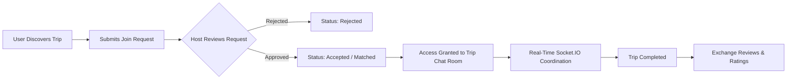

# Vromon Shongi — Tour The World Together

[](https://nextjs.org/)
[](https://react.dev/)
[](https://www.typescriptlang.org/)
[](https://tailwindcss.com/)
[](https://socket.io/)
[](https://stripe.com/)
[](https://vromon-shongi.vercel.app/)

> **Vromon Shongi** is a full-stack, real-time travel companion platform designed to connect solo and group travelers across the globe. Built with a modern Next.js 16 (App Router & Turbopack) frontend and an Express/Prisma/PostgreSQL backend, it enables travelers to discover curated trip plans, coordinate join requests, chat in real-time rooms, subscribe for verified badges, and exchange peer-to-peer reviews.

---

## Live Deployments

* **Live Frontend App:** [vromon-shongi.vercel.app](https://vromon-shongi.vercel.app/)
* **Live Backend API:** [travel-buddy-backend-73ls.onrender.com](https://travel-buddy-backend-73ls.onrender.com/)
* **Health Check Endpoint:** [travel-buddy-backend-73ls.onrender.com/health](https://travel-buddy-backend-73ls.onrender.com/health)

---

## Key Features

### 1. Trip Discovery & Intelligent Filtering
* **Dynamic Search & Filtering:** Filter plans in real-time by destination, travel style (`Solo`, `Family`, `Friends`), date ranges, and budget tiers.
* **Rich Trip Profiles:** Detailed itineraries, estimated expenses, activity lists, host profile previews, and accepted participant rosters.

### 2. Travel Buddy Request & Matching Lifecycle
* **Join Requests with Custom Notes:** Users can submit join requests to trip creators with personalized notes.
* **Host Control Center:** Hosts review incoming requests and have one-click `Approve` or `Reject` actions.
* **Instant UI Feedback:** Instant optimistic state transitions (`Pending Approval`, `Approved`, `Rejected`) preventing duplicate applications.

### 3. Real-Time Group Chat Coordination (Socket.IO)
* **Access-Gated Chat Rooms:** Dedicated group chat rooms created automatically for each trip, strictly accessible to the host and approved participants.
* **Zero-Latency Optimistic UI:** Sent messages render immediately in the user's inbox with background socket synchronization.
* **Live Indicators:** Real-time typing indicators (`"User is typing..."`) and automatic reconnection resilience.
* **Visual Hierarchy:** Distinct `Host` badges and verified traveler indicators.

### 4. Role-Based Dashboards
* **User Dashboard:**
  * **Overview:** High-level activity metrics and recent trips.
  * **My Travel Plans:** Create, update, and manage hosted trips with date validation.
  * **Request Management:** Track outgoing join requests and triage incoming requests.
  * **Matched Travelers & Reviews:** View travel companions and leave verified ratings and reviews.
  * **Profile Customization:** Profile photo uploads, bio, contact details, and travel preferences.
* **Admin Dashboard:**
  * **Platform Overview:** Comprehensive stats on total users, active trips, and platform engagement.
  * **User Management:** Moderation controls to activate, ban, or update user permissions.
  * **Travel Plan Oversight:** Moderate, filter, and inspect all platform travel plans.
  * **System Activity:** Audit platform activity feeds.

### 5. Stripe Subscriptions & Verified Traveler Status
* Integrated Stripe Checkout for monthly and annual subscriptions.
* Grants verified badge perks (`verifiedBadge`), increasing trust within the travel community.

### 6. Modern Design & Micro-Interactions
* Built with **Tailwind CSS v4** and **Radix UI** primitives.
* Fluid animations and transitions powered by **Motion (Framer Motion)**.
* Accessible theme colors, custom loading skeletons, and interactive toast notifications via **Sonner**.

---

## Architecture & Workflow



---

## Tech Stack

| Domain | Technology |
|---|---|
| **Framework** | [Next.js 16 (App Router, Turbopack)](https://nextjs.org/) |
| **Language** | [TypeScript 5](https://www.typescriptlang.org/) |
| **Core UI & Styling** | [React 19](https://react.dev/), [Tailwind CSS v4](https://tailwindcss.com/) |
| **UI Components** | [Radix UI Primitives](https://www.radix-ui.com/), [Lucide React Icons](https://lucide.dev/) |
| **Animations & Carousels** | [Motion (Framer Motion)](https://motion.dev/), [Swiper](https://swiperjs.com/) |
| **Real-Time Communication** | [Socket.IO Client](https://socket.io/) |
| **Form & Feedback** | Controlled Forms, [Sonner Toasts](https://sonner.emilkowal.ski/) |
| **Authentication & Security** | JWT (Cookie-based), Middleware route protection |
| **Payments** | [Stripe Payment Gateway](https://stripe.com/) |
| **Backend & Database** | Node.js, Express.js, Prisma ORM, PostgreSQL |
| **Deployment & Hosting** | [Vercel](https://vercel.com/) (Frontend), [Render](https://render.com/) (Backend) |

---

## Project Structure

```bash
vromon-shongi-client/
├── app/
│   ├── (mainLayout)/              # Public routes (Home, Trips, Details, About)
│   │   ├── trips/                 # Trip discovery & detail views
│   │   ├── login/                 # Authentication pages
│   │   ├── signup/                
│   │   └── subscription/          # Stripe checkout plans
│   ├── (dashboardLayout)/         # Protected role-based dashboard routes
│   │   ├── user/dashboard/        # Traveler dashboard (Plans, Requests, Chat Rooms)
│   │   │   └── join-room/[tripId] # Live Socket.IO group chat room
│   │   └── admin/dashboard/       # Administrative management routes
│   └── globals.css                # Tailwind CSS v4 design tokens & theme setup
├── components/
│   ├── modules/                   # Domain modules (chat, trips, dashboard, auth)
│   ├── shared/                    # Reusable components (Navbar, Footer, TripCards, Modals)
│   └── ui/                        # Radix UI wrappers (Avatar, Dialog, Badge, Select, etc.)
├── config/
│   └── websocket/                 # Socket.IO connection client & URL sanitizer
├── lib/
│   ├── serverFetch.ts             # SSR fetch client with cookie forwarding & no-store caching
│   └── utils.ts                   # Class merging & format utilities
├── services/                      # Server actions & API integration layer
│   ├── auth/                      # Authentication & token verification
│   ├── travelPlan/                # Trip plans CRUD & filtering
│   ├── trip-participant/         # Join requests & approval workflows
│   ├── chat-room/                 # Chat room authorization
│   └── chat-message/              # Message history retrieval
└── types/                         # TypeScript interfaces and shared data types
```

---

## Getting Started

### Prerequisites
* **Node.js**: v20.x or higher
* **Package Manager**: `npm`, `pnpm`, or `yarn`

### 1. Clone the Repository
```bash
git clone https://github.com/nabilsiddik/vromon-shongi-client.git
cd vromon-shongi-client
```

### 2. Install Dependencies
```bash
npm install
```

### 3. Configure Environment Variables
Create a `.env.local` file in the root directory:

```env
# Backend REST API URL (Include /api/v1)
NEXT_PUBLIC_SERVER_URL=http://localhost:5000/api/v1
# Production: NEXT_PUBLIC_SERVER_URL=https://travel-buddy-backend-73ls.onrender.com/api/v1

# Socket.IO Server URL (Host origin without /api/v1)
NEXT_PUBLIC_SOCKET_SERVER_URL=http://localhost:5000
# Production: NEXT_PUBLIC_SOCKET_SERVER_URL=https://travel-buddy-backend-73ls.onrender.com

# JWT Access Secret for client cookie verification
JWT_ACCESS_SECRET=your_jwt_access_secret_key

# Stripe Public Key (For premium subscriptions)
NEXT_PUBLIC_STRIPE_PUBLIC_KEY=pk_test_your_stripe_public_key

# Environment
NEXT_PUBLIC_NODE_ENV=development
```

### 4. Run Development Server
```bash
npm run dev
```

Open [http://localhost:3000](http://localhost:3000) with your browser to explore the application.

### 5. Build for Production
```bash
npm run build
npm run start
```

---

## Security & Performance Highlights

* **Server-Side Token Verification:** Sensitive dashboard routes are guarded using Next.js Middleware and SSR cookie validation.
* **Cache-Safe SSR:** Real-time data endpoints implement `cache: 'no-store'` to prevent stale responses in production edge environments.
* **Resilient WebSockets:** Dynamic fallback URL parsing ensures seamless Socket.IO connections across both local environments and distributed CDN deployments.
* **Input & Date Validation:** Client and server-side constraints guarantee chronological trip dates (`endDate > startDate`) and sanitized user inputs.

---

## Author

**Nabil Siddik**
* **Portfolio / GitHub:** [@nabilsiddik](https://github.com/nabilsiddik)
* **Live Application:** [Vromon Shongi on Vercel](https://vromon-shongi.vercel.app/)
